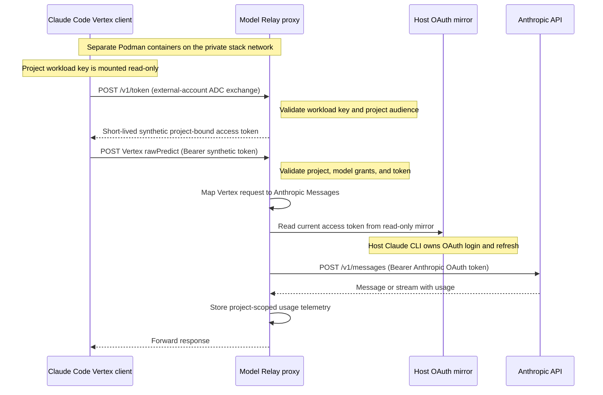

# model-relay

A Rust gateway with Vertex and Anthropic Messages interfaces for Claude Code, with persistent SQLite usage
telemetry and a separate private REST listener. It includes a mock backend and an
Anthropic Messages adapter with server-owned bearer credentials. The adapter is
validated against an isolated synthetic provider and a live Claude Code turn.
Upstream accounts can be connected through the web admin console using a
browser authorization link and pasted code; the relay stores and refreshes
those accounts independently. The existing host-login profile remains an
access-only, read-only mirror with refresh owned by the host CLI.

```text
host Honcho / Procfile.dev (Procfile.oauth adds a host credential watcher)
  |
  +-- Podman: Anthropic client   own home + work bind mount; local API key
  |              | Messages URLs, x-api-key
  |              v
  +-- Podman: Rust vertex-shim   source mounts + Cargo/build volumes
  |              ^
  |              | Vertex URLs, mock Google bearer
  +-- Podman: Vertex client      separate home + work bind mount; native ADC

  proxy: :8080 Messages + Vertex inference (host loopback)
         :8081 /api/private/v1/* (separate admin key)
         :8082 mock Google metadata (container network only)
         SQLite -> persistent telemetry volume
         Anthropic adapter -> fixture / configured HTTPS origin
         upstream OAuth/bearer mounted only in proxy
```

## Vertex authentication flow

In `mock-federated` mode, Claude Code uses its native Google ADC support. The
client key and synthetic Google token authenticate the client to Model Relay;
the proxy separately uses its server-side Anthropic OAuth credential with the
upstream provider. This sequence shows `liveoauth`'s default profile.



The client token is synthetic and validated locally; Model Relay does not
exchange it with Google. Other projects can select another proxy-side upstream
profile. For the default profile, the host OAuth mirror contains only the
upstream access token. Claude Code never receives that token, and the Anthropic
API never receives the client's synthetic Google token.

## Start

Requires rootless Podman, Python 3.13/uv, and host Honcho. Install Claude Code
inside the client and proxy images through Anthropic's native curl installer. Version
2.1.293 is pinned and verified; base images are digest-pinned. Debian package
repositories and the remote installer itself are still mutable inputs.

```bash
uv venv --python 3.13 .venv
uv pip install --python .venv/bin/python -r requirements-dev.txt
./scripts/dev.sh build-images
./scripts/dev.sh start
```

`start` creates three containers: one proxy, one Anthropic Messages/API-key client,
and one Vertex/mock-ADC client. They share an internal network with no external
routing, distinct client identities, and separate Claude homes/work directories.
The launcher generates local inference/admin credentials in ignored
`.state/dev/`, waits for readiness, and supervises foreground services with
Honcho. Host ports bind only `127.0.0.1`. Mock containers receive no host Claude
state, Google credentials, or upstream OAuth credentials. Shared Honcho `.env`
loading is disabled; wrappers pass only the selected settings and mounts.

In another terminal:

```bash
./scripts/dev.sh exec client claude-proxy -p 'Say hello.' --tools '' --max-turns 1
./scripts/dev.sh exec client claude-proxy
./scripts/dev.sh exec vertex-client claude-proxy
./scripts/dev.sh telemetry requests
./scripts/dev.sh telemetry summary
./scripts/dev.sh telemetry export
./scripts/smoke.sh
./scripts/test-stack.sh             # disposable stack and lifecycle acceptance
./scripts/test-dual-client.sh       # concurrent native clients, auth, isolation, lifecycle
```

The Anthropic client's `/work` is a writable bind mount of `client-work/<session>/` on the
host (`client-work/dev/` by default). Files created by Claude are immediately
readable there and survive container recreation. The home directory remains a
named volume. Override the work directory before starting a session with
`SHIM_CLIENT_WORK_DIR=/absolute/path/to/project`; paths with spaces are supported.
The rootless client uses your host UID, so created files remain owned by you.
An explicitly empty `SHIM_CLIENT_WORK_DIR` selects the legacy named work volume;
fixture acceptance scripts select that mode themselves. Existing named work
volumes are preserved, but their contents are not automatically copied into a
new bind directory. The existing `liveoauth` files have been migrated to
`client-work/liveoauth/`, with the original work volume retained as a backup.

The Vertex client's `/work` defaults to `client-work/<session>-vertex/`, with its
own `vertex-shim-<session>-vertex-client-home` volume. Set `SHIM_VERTEX_WORK_DIR`
to override it, or to an empty string for a named work volume. The existing
primary client's name/home/work remain compatible; `exec anthropic-client` is an
alias for `exec client`. Set `SHIM_CLIENT_LAYOUT=single` before starting to use
the legacy two-container profile with a selectable client mode.

The default dual profile enables metadata authentication for `vertex-inference`
and creates a separate `claude-code-vertex` registry identity. Fresh primary
identities permit catalog models; existing primary grants are preserved.
Both local API-key header formats and mock ADC work concurrently on the same
proxy. Telemetry records the client/key identity, API, and authentication scheme.
Honcho stops the whole stack if any client, proxy, or credential watcher exits.

This mock proves transport/auth/telemetry plumbing. It does not reason about a
repository or execute an agentic tool-use scenario. All returned counts are
synthetic, not estimates from a tokenizer.

## Development

Edit `src/` on the host, then run commands inside containers:

```bash
./scripts/test.sh                   # offline unit tests, formatting, Clippy
./scripts/dev.sh exec proxy cargo check --locked --offline
./scripts/dev.sh restart            # build and replace the process, same container
./scripts/dev.sh status
./scripts/dev.sh stop
```

Source is mounted read-only in the proxy; test formatting uses an explicit
writable source mount. Cargo caches and build output use named volumes. A failed
build leaves the active binary running. Health and request records expose a
source/dependency build ID. Rebuild images for toolchain/dependency/image changes;
source edits use `podman exec`. Ctrl-C stops the session; telemetry, client state,
and Cargo volumes are preserved. No global prune is used.

The proxy writes one JSON line per event to stdout. Tail the live OAuth proxy:

```bash
podman logs --follow --tail 100 vertex-shim-liveoauth-proxy
# Default mock session:
podman logs --follow --tail 100 vertex-shim-dev-proxy
```

Events include `startup`, `request_completed`, `request_rejected`,
`upstream_failure`, `shutdown_started`, `shutdown`, and `service_failed`.
Completion logs include request/attempt IDs, models, HTTP status, latency,
numeric token usage, and context capacity when known. Streaming requests log
their terminal state, including partial usage on cancellation or failure.
Upstream failures have an additional correlated error event. Rejections before
an inference lifecycle starts receive a request ID in the response and log;
they are not added to inference telemetry. Successful health polls are quiet.
Logs exclude credentials, request/response bodies, tools, arbitrary headers,
run labels, client/key labels, and provider error messages. SQLite telemetry
remains available through the private REST API. Cargo build output also appears
in development container logs.

`VERTEX_SHIM_SESSION` scopes container/network/state names. Use
`SHIM_HOST_PORT` and `SHIM_HOST_ADMIN_PORT` for concurrent sessions. Dependency
caches are shared by toolchain, while per-session build/state volumes are separate.
`./scripts/test-client.sh` separately verifies the pinned CLI against a synthetic
Vertex fixture with disposable client state and sanitized request-shape logs.

For a clean source-baked build with tests and lint checks and no source mounts:

```bash
podman build -t localhost/vertex-shim:0.1.0 .
./scripts/test-runtime.sh           # native client + REST tests on baked image
```

## Build the deployment image

The root `Dockerfile` builds the production relay, including the web admin
console and pinned Claude OAuth login helper. Build from this repository root:

```bash
docker build -t model-relay:local .
# Or, with rootless Podman:
podman build -t localhost/model-relay:local .
```

Tag/push that image to your cluster's registry, or load it into your local
cluster using its image-loading command. The image runs as UID/GID 1000 and
starts the compiled relay directly; it needs no source mounts or Cargo at runtime.
The build runs formatting, tests, and Clippy before producing the release binary.
`.dockerignore` limits the build context to source and build inputs;
`.containerignore` points to the same rules for Podman. The previous
`containers/Containerfile.runtime` path is a compatibility link to `Dockerfile`.

Provide the following at deployment time:

| Setting or mount | Purpose |
| --- | --- |
| `/config/keys.json` | Client key registry; `{ "keys": [] }` starts with no bootstrap keys |
| `/config/models.json` | Model aliases; `{}` allows managed projects to use upstream catalog grants |
| `/run/secrets/admin-api-key` | Admin key mounted from a Kubernetes Secret |
| Writable persistent `/data` | SQLite state and managed OAuth credentials, owned by runtime UID 1000 |
| Writable `/tmp` | Temporary files when the container root filesystem is read-only |
| `SHIM_ADMIN_LISTEN=0.0.0.0:8081` | Allow the private admin listener to be reached through a pod Service |

Inference listens on port 8080. Keep admin port 8081 scoped to administrators.
Use a single replica and `Recreate` rollout with the persistent SQLite/credential
volume. A fresh deployment defaults to the mock backend; connect an upstream
account in the admin console and assign production projects to its profile.
See [managed upstream accounts](docs/upstream-accounts.md) for the OAuth setup
and [project administration](docs/projects.md) for client credentials.

## Connect upstream OAuth accounts

Open the admin console, select **Upstream accounts**, and **Add account**.
Save an account ID/name, open or copy the authorization link into your browser,
authorize the desired Anthropic account, and paste the resulting code into the
console. The relay runs the pinned `claude auth login --claudeai` command with
an isolated home/config directory. The browser runs on your machine; the pod
needs no browser or inbound OAuth callback port. Failed or cancelled reconnects
preserve the previous credentials until you explicitly disconnect.

After connecting, edit a project and select the account ID as its upstream
profile. Client authentication remains Vertex workload exchange, Anthropic API
key, or MaaS API key; all three use the project's selected upstream account.
The account view offers status, reconnect, access refresh, rename, disconnect,
and deletion. Reassign projects before deleting an account. Login attempts
expire after ten minutes; at most four can run simultaneously.

Account metadata is in SQLite. Managed access/refresh credentials live in
owner-only directories under `/data/oauth-accounts/`, on the same persistent
volume as SQLite. Existing host mirrors stay read-only. Refreshes are serialized
per account and saved by atomic replacement. Codes, credentials, and raw login
output are excluded from telemetry and stdout; the private login-status API
returns the authorization URL only to an authenticated administrator.

For Kubernetes, persist `/data`, supply the admin key as a Secret, expose only
the admin listener to administrators, and allow proxy egress to Anthropic's
login/token and inference services. Use one relay replica and a **Recreate**
rollout with this SQLite/file-backed store: a volume ownership lock refuses a
second credential owner. Run as UID 1000 with a writable volume and preserve
mode 0700 account directories / 0600 credential files. An empty deployment can
start with `SHIM_BACKEND=mock` and configure managed accounts through the UI;
assign production projects to those accounts before issuing client tokens.
The bootstrap `default` profile remains a development simulator in that mode.
For a local stack, `SHIM_UPSTREAM_EGRESS_NETWORK` allows an explicitly supplied
proxy egress network even when starting with the mock bootstrap backend.

See [managed account APIs and settings](docs/upstream-accounts.md) for REST
routes, credential ownership, and persistence details.

## Authentication and models

Inference accepts `Authorization: Bearer <local-key>` or `x-api-key: <local-key>`.
Keys are opaque; the verifier registry is `.state/dev/config/keys.json` and
reloads on each request, so revocation/rotation does not require an image restart.
The default Vertex client uses native ADC against the mock metadata listener.
In single-client API-key/Vertex mode, the wrapper uses
`CLAUDE_CODE_SKIP_VERTEX_AUTH=1` and custom bearer headers.
For the tested CLI, `ANTHROPIC_VERTEX_BASE_URL` must end in `/v1`.

The mock deployment model registry is `.state/dev/config/models.json`; edit and
restart the proxy to change it. Unknown context capacity remains `null`. Set a
positive `window_tokens` value when you want an explicit deployment override.
Grant any additional model IDs in the key registry and use `VERTEX_SHIM_MODEL`
to select the corresponding client model.

The default dual-client Vertex identity has `"vertex_catalog_models": true`,
which permits every model reported by the upstream catalog on Vertex routes.
The mock-ADC wrapper fetches
`GET /v1/models?client_api=vertex&limit=1000` with a synthetic metadata credential
and builds an authorized picker using upstream names and metadata. Dated IDs
are translated from `claude-…-YYYYMMDD` to `claude-…@YYYYMMDD`; undated IDs,
including `claude-opus-4-6`, stay unchanged. Routing resolves those catalog IDs
without a static model entry. Native Claude still obtains its own inference
token through ADC, with no injected auth header. For example:

```bash
VERTEX_SHIM_SESSION=liveoauth ./scripts/dev.sh exec vertex-client \
  claude-proxy --model=claude-opus-4-6
```

Unknown `--model` selections fail in the wrapper with a model-permission
message instead of Claude's misleading Google authentication error. This list
describes the shim's upstream account, rather than a Google project's Model
Garden. Context capacity comes from upstream metadata unless a configured
deployment overrides it. Reopen Claude to refresh the picker; the proxy caches
catalog metadata for up to 60 seconds and checks current grants on every request.

`vertex_catalog_models` defaults to false and is independent of Messages
`catalog_models`. Without it, Vertex remains restricted to explicitly granted
static deployments; shipped fallback mappings include Sonnet 4.5 and Haiku 5.5.
Existing session registries are preserved at launch. The running `liveoauth`
Vertex identity has catalog access enabled; setting the field to false revokes
catalog access immediately without changing ordinary model grants.

### Mock Google authentication

Set `SHIM_CLIENT_AUTH=mock-adc` with `SHIM_CLIENT_API=vertex` to let the native
Claude client exercise its normal Google Application Default Credentials (ADC)
chain. It discovers the proxy's synthetic metadata service and obtains expiring
bearer tokens; the wrapper removes the skip-auth flag and custom authorization
header, and no local inference-key file is mounted in this client.

Start a fresh, offline mock session:

```bash
VERTEX_SHIM_SESSION=mockadc SHIM_CLIENT_LAYOUT=single SHIM_CLIENT_API=vertex SHIM_CLIENT_AUTH=mock-adc \
  SHIM_HOST_PORT=0 SHIM_HOST_ADMIN_PORT=0 ./scripts/dev.sh start
# In another terminal:
VERTEX_SHIM_SESSION=mockadc ./scripts/dev.sh exec client claude-proxy
./scripts/test-mock-adc.sh
```

The same client-auth mode can front the `anthropic` backend and its separate
OAuth or bearer-file credential. Set those upstream options as in the profiles
below, using a fresh session name. Mocked Google tokens are consumed locally;
the proxy substitutes its server-owned upstream credential. Client auth and
upstream auth are independent. In the default dual profile this metadata mode
is enabled for the Vertex client alongside the Messages/API-key client.

The proxy opens a separate metadata listener on container port 8082 only when
`SHIM_MOCK_ADC_KEY_ID` is set. The launcher supplies `dev-inference` for mock-ADC
clients, and grants `mock_adc: true` in a newly created key registry. Existing
registries are preserved: explicitly enable that field on the selected identity
before switching an existing session. The key ID must identify exactly one
registry entry. Each issued token inherits that entry's client identity and
current model/backend grants; revocation and key rotation apply to outstanding
tokens on their next request. Opaque API keys continue to work alongside it.

`SHIM_MOCK_ADC_TOKEN_TTL_SECONDS` defaults to 600 and accepts 1–3600 seconds.
`SHIM_MOCK_ADC_PROJECT` defaults to `vertex-shim-local`.
`SHIM_MOCK_ADC_HOST` selects the client metadata host, defaulting to
`vertex-shim:8082`; the wrapper sets `GCE_METADATA_HOST`, `GCE_METADATA_IP`, and
`METADATA_SERVER_DETECTION=ping-only`. A client home with an existing well-known
Google ADC file is rejected, so use a separate home/session for this mode.

Port 8082 is not published to the host. This mock endpoint models one workload
identity per proxy and trusts peers on the selected Podman network;
use the [project-specific federation mode](docs/projects.md) for distinct identities.
`Metadata-Flavor: Google` is a protocol header, not a password. It is an opt-in
development simulator, without browser login, Google IAM, or Google credential
validation. It stores at most 4096 active token hashes in memory; tokens expire
and are lost when the proxy process restarts. Google auth clients can reacquire
tokens from the metadata service. Token strings and hashes are excluded from
logs and REST telemetry; `auth_scheme: mock-adc` identifies inference records,
and the private auth-status endpoint exposes only issuer counters and lifetime.

Native Claude Code 2.1.293 has been verified against this path, including two
turns in one process and renewal with two-second tokens. This build fetches a
fresh token on each observed inference turn; caching frequency belongs to the
client. The simulator accepts reusable and concurrent unexpired tokens.

Protocol references: [Claude's Google authentication](https://code.claude.com/docs/en/google-vertex-ai#3-configure-gcp-credentials),
[ADC discovery order](https://docs.cloud.google.com/docs/authentication/application-default-credentials),
[metadata host configuration](https://github.com/googleapis/gcp-metadata#environment-variables),
and [Google's metadata token implementation](https://github.com/googleapis/google-auth-library-nodejs/blob/main/src/auth/computeclient.ts).

## Anthropic adapter

```bash
./scripts/test-upstream.sh          # disposable client/proxy/provider fixture
```

The fixture suite runs on an internal Podman network using generated credentials.
It verifies native Claude Code, local API-key auth, distinct upstream bearer auth,
model/version translation, beta/workspace headers, token rotation, tool response
blocks, counting, gzip, incremental SSE, cumulative usage, cancellation, timeouts,
HTTP/SSE errors, and telemetry privacy. It makes no paid provider calls.

Select `SHIM_BACKEND=anthropic` in a separate session. Set
`SHIM_UPSTREAM_BASE_URL` to the server-controlled HTTPS origin and
`SHIM_UPSTREAM_TOKEN_FILE` to a mode-0600 file containing only the bearer credential.
Only the proxy mounts that file. HTTP origins require the explicit
`SHIM_UPSTREAM_SYNTHETIC=true` fixture setting. Redirects and environment HTTP
proxies are disabled. Set `SHIM_UPSTREAM_WORKSPACE` if your credential requires a
workspace header; the client cannot override it. The total upstream timeout is
`SHIM_UPSTREAM_TIMEOUT_SECONDS` (default 120, range 1–600). Managed upstream
profiles and UI-managed OAuth accounts use the same setting, including
accounts restored after a restart. Timeouts during streaming are recorded as
`timeout_error`, with partial usage and the original HTTP status (usually 200
because response headers have already been sent). Other stream read failures
remain `upstream_stream_error`.

The model registry must supply `upstream_model` for each configured Vertex ID;
the default maps `claude-sonnet-4-5@20250929` to `claude-sonnet-4-5-20250929`.
New sessions grant keys only the selected backend. Existing sessions need an
explicit registry grant and model mapping before changing backends.

Normal dev sessions retain an internal network. To enable provider connectivity,
create a separate Podman network and pass its name as
`SHIM_UPSTREAM_EGRESS_NETWORK`; it attaches only to the proxy, while the client
stays on the internal network. That explicitly supplied network is user-owned
and survives stack shutdown. The `liveoauth` session has been verified against
Anthropic with the pinned native client.

For clients that also need Internet access (for example, cloning GitHub repos),
set `SHIM_CLIENT_EGRESS_NETWORK` before starting. Both client containers join
that explicitly supplied, user-owned network; it survives shutdown. The running
`liveoauth` profile uses `vertex-shim-oauth-egress` for both clients and the proxy.

Bearer-file credentials are re-read for each request. That individual file bind
requires rotation to update the mounted inode; an atomic host rename needs
container recreation. The OAuth mirror uses a directory mount and follows atomic
replacement without recreation. No whole `~/.claude` tree is mounted.

[Anthropic documents bearer API keys and federated access tokens](https://platform.claude.com/docs/en/manage-claude/authentication).
The separate experimental Claude OAuth profile below was verified with native
Claude Code and the existing host login. This observation does not establish a
general public API contract for subscription tokens or arbitrary clients.

## Reuse the existing Claude login

The selected profile leaves host credentials unchanged. Honcho starts three runtime
containers and a host Python watcher. The watcher opens the host credential file
read-only, checks ownership/permissions, and atomically mirrors only
`claudeAiOauth.accessToken`, `expiresAt`, and `scopes` into
`.state/<session>/auth/`. Refresh tokens and unrelated native credentials are
excluded. Only the Rust proxy mounts this mirror, read-only. The Messages client
gets its local API key; the Vertex client acquires synthetic Google tokens.
Each has a separate home volume and host work bind mount.

```text
host Claude CLI -> host credential file (login + refresh owner)
                         |
                   read-only watcher (Honcho)
                         |
                   access-only mirror
                         | directory mount, read-only
Messages client -- local API key --+--> Rust proxy --> Anthropic
Vertex client --- mock Google ADC-+    upstream OAuth bearer
```

Start a fresh profile after logging in with the host Claude CLI:

```bash
podman network create --ignore vertex-shim-oauth-egress
export VERTEX_SHIM_SESSION=liveoauth
export SHIM_BACKEND=anthropic
export SHIM_UPSTREAM_AUTH=claude-oauth
export SHIM_UPSTREAM_BASE_URL=https://api.anthropic.com
export SHIM_UPSTREAM_EGRESS_NETWORK=vertex-shim-oauth-egress
export SHIM_CLIENT_LAYOUT=dual
export SHIM_HOST_PORT=0 SHIM_HOST_ADMIN_PORT=0
./scripts/dev.sh start
```

A `liveoauth` stack is already running from validation. In another terminal:

```bash
VERTEX_SHIM_SESSION=liveoauth ./scripts/oauth.sh status
VERTEX_SHIM_SESSION=liveoauth ./scripts/dev.sh exec client claude-proxy
VERTEX_SHIM_SESSION=liveoauth ./scripts/dev.sh exec vertex-client claude-proxy
VERTEX_SHIM_SESSION=liveoauth ./scripts/dev.sh exec client env \
  CLAUDE_CODE_MAX_RETRIES=0 CLAUDE_CODE_MAX_OUTPUT_TOKENS=128 MAX_THINKING_TOKENS=0 \
  claude-proxy -p 'Reply only with OK.' --tools '' --max-turns 1
VERTEX_SHIM_SESSION=liveoauth ./scripts/dev.sh telemetry requests
VERTEX_SHIM_SESSION=liveoauth ./scripts/dev.sh stop
```

The upgraded live session's launch settings, including its preserved host
ports, are saved in `.state/liveoauth/start-dual.sh`. After stopping it, use
`./.state/liveoauth/start-dual.sh` to start the same three-container profile again.

The smoke-turn limits above are for validation, not a general coding session.
The host file defaults to `CLAUDE_SECURESTORAGE_CONFIG_DIR/.credentials.json`,
then `CLAUDE_CONFIG_DIR/.credentials.json`, then `~/.claude/.credentials.json`.
Use `SHIM_HOST_OAUTH_FILE` to select another native credential file.
`SHIM_OAUTH_DIR` selects the dedicated mirror directory; keep it separate from
host Claude state. `SHIM_OAUTH_MODE` accepts only `read-only`.

The watcher polls every 0.5 seconds and follows host atomic replacements. Missing,
malformed, insecure, or logged-out host credentials invalidate the mirror. The
proxy checks expiry per request and rejects tokens within 60 seconds of expiration
with HTTP 503 before inference. Use the host Claude CLI to refresh/log in; this
host-mirror profile never invokes host login or refresh. Regular watcher shutdown removes the
mirror; losing the watcher makes Honcho stop all containers. Python watcher
errors and private auth status never print credential values.

The OAuth adapter adds `oauth-2025-04-20` and retains its own `vertex-shim` user
agent. It does not add a fake native identity or change prompt/tool fields.
The live native CLI replied `OK.` and reported complete usage. A minimal REST
probe received HTTP 429; arbitrary client compatibility and other live operations
remain unverified. Very small output caps can trigger extra client recovery
requests even with SDK transport retries disabled; each appears separately in
telemetry. See [validation evidence](docs/validation.md).

## Messages interface and accurate model selection

`SHIM_CLIENT_API=messages` launches Claude with `ANTHROPIC_BASE_URL` pointing at
the proxy, a local `ANTHROPIC_API_KEY`, and provider flags unset. The proxy
exposes `POST /v1/messages`, `POST /v1/messages/count_tokens`, `GET /v1/models`,
and `GET /v1/models/{id}` alongside its Vertex routes. Streaming/nonstreaming
generation shares the same upstream adapter, private telemetry, and stdout logs.
Records include `client_api`; context capacity on the Messages interface comes
from upstream model metadata when supplied.

Discovery fetches the upstream Models API with the proxy's credential, then
filters it by the requesting local key's grants. An explicit
`"catalog_models": true` on a key permits any model present in that catalog on the Messages
interface; the default is false. Without it, explicit native model grants and
the key's configured Vertex-to-upstream mappings determine visible models.
Unknown model IDs are rejected before inference. This permission does not grant
arbitrary Vertex IDs or admin access. Registry changes apply per request.

The client fetches the authorized catalog at launch and creates a session-only
`modelPicker` lineup with upstream IDs/names, replacing built-in rows. The
standard Default/current-model rows may still appear. It preserves a saved model
when that exact ID remains authorized, otherwise selects the newest catalog
Sonnet, or the first authorized model. `SHIM_MESSAGES_MODEL` or `--model` selects
another model. Family aliases each point to their corresponding catalog model;
they are no longer all redirected to Sonnet. Native gateway discovery is enabled
as well. The launcher fails if discovery fails instead of showing a stale menu.

The proxy caches catalog metadata for up to 60 seconds, revalidates credentials
on every read, invalidates on credential rotation, and filters current key grants
after cache lookup. Catalog requests have a 2.5-second deadline and a 1 MiB/1000
model bound. An incomplete upstream page fails discovery. Reopen Claude to
refresh its menu. Catalog presence is the upstream's availability report;
individual generations can still fail due to entitlement, rate limits, or other
provider checks. No generation is performed merely to list models.

The client wrapper is source-mounted read-only, so wrapper edits take effect on
the next invocation. Changing `SHIM_CLIENT_API` or the installed CLI version
requires recreating the client stack; home/telemetry volumes and the host work
directory are preserved.
The default dual-client profile fixes the primary client to Messages/API-key and
the second client to Vertex/mock-ADC. `SHIM_CLIENT_API` and `SHIM_CLIENT_AUTH`
select the client mode only in the optional `SHIM_CLIENT_LAYOUT=single` profile.

```bash
./scripts/test-messages.sh          # native client, discovery, permissions, REST
```

Protocol sources: [Models API](https://platform.claude.com/docs/en/api/models/list),
[gateway discovery](https://code.claude.com/docs/en/llm-gateway-protocol#model-discovery),
and [model picker settings](https://code.claude.com/docs/en/settings-reference#modelpicker).

```bash
./scripts/test-host-oauth.sh        # synthetic host rotation/logout + native client
```

## Project identities and administration

The proxy supports multiple project identities, each with its own client keys,
model grants, upstream credential profile, and telemetry. Existing clients use
the built-in `vertex-shim-local` project. Project and credential CRUD is served
on the authenticated admin listener under `/api/private/v1/projects`; changes
persist in SQLite and apply without a proxy restart. Vertex routes enforce the
credential's project; Messages requests derive it from the credential.

```bash
./scripts/admin.py --session liveoauth GET /projects
./scripts/admin.py --session liveoauth GET /projects/vertex-shim-local/telemetry/summary
./scripts/test-projects.sh
```

New Vertex clients can use `SHIM_CLIENT_AUTH=mock-federated` to acquire
project-bound tokens through native Google external-account ADC. Projects can
share the existing upstream OAuth mirror or select separately mounted upstream
profiles. Real provider credentials remain in the proxy. See
[project CRUD, credential issuance, and client launch examples](docs/projects.md).

## Telemetry REST

The admin listener also serves a browser console at `/admin/`. Get the URL for
your running session with:

```bash
VERTEX_SHIM_SESSION=liveoauth ./scripts/dev.sh admin-url
```

Enter the admin key from `.state/<session>/admin-api-key` in the connect form.
The console includes filtered telemetry, token/context usage, request details,
project editing, and credential issuance, grant editing, rotation, and revocation.
The **Project / API key** telemetry selector groups each project's keys by
identity, including MaaS, Anthropic, Vertex workload, and file-registry keys.
Select a whole project or one key, then apply the filters. Key selections use
both `project_id` and `key_id`, so clients sharing a name remain distinct.
It uses the existing private API; the key stays in browser memory and is cleared
on disconnect or reload. Newly issued credentials are shown once for copying or
downloading. UI assets are embedded in the relay binary, with no separate UI
container, dependency installation, or external asset requests.

The token form inherits **Anthropic OAuth** from the project's upstream profile.
Anthropic and MaaS API keys authenticate directly; Vertex workload keys must
first exchange for a Google bearer token. The form sets these permissions
automatically and offers one catalog-access checkbox. Existing keys retain
their current authentication permissions.

Telemetry totals cover the pages loaded in the console; use **Load more requests**
to include further pages. API-key token counts and model context occupancy are
distinct from the upstream account's subscription quota, which is not collected.

Telemetry is written off the request path by one writer thread, which commits
whatever is queued in one transaction and keeps only the latest copy of each
request record. When more than 1,024 writes are queued, streamed usage
snapshots are dropped first; final request records are kept up to 65,536
queued writes. `/health` counts both kinds of drop since start, and the
console warns only about request drops or storage errors in the last 15
minutes.

Admin requests require the separate bearer key stored in `.state/dev/admin-api-key`.
The private namespace is served only on the admin listener:

| GET path under `/api/private/v1` | Result |
| --- | --- |
| `/auth/status` | Auth mode, host refresh ownership, readiness, and expiry; no tokens |
| `/health` | Pending writes, storage errors, dropped requests and usage events, persistence time, last drop and error times |
| `/telemetry/requests` | Request summaries, cursor pagination |
| `/telemetry/requests/{id}` | One request and its single attempt ID |
| `/telemetry/requests/{id}/events` | Paginated numeric usage snapshots |
| `/telemetry/summary` | Token totals and usage-status counts for a bounded page |
| `/telemetry/export` | JSON page; `format=jsonl` returns NDJSON |

List/summary/export support `project_id`, `run_id`, `client_id`, `key_id`, `backend`, `model`,
`operation`, `usage_status`, `synthetic`, RFC3339 `from`/`to`, `cursor`, `limit`, and
`order` (`asc`, the default, oldest first; `desc`, newest first, which the console uses).
Limits are 1–500 (default 100); each summary covers one page, and returns a cursor
when another page exists. Summary `synthetic` is `null` for mixed pages, with
separate synthetic/provider request counts. JSONL pagination uses `x-next-cursor`. Reads use four
bounded blocking workers, a 250 ms SQLite execution budget, and a 500 ms lock
wait budget. Queries are fixed and parameterized. Arbitrary SQL is not accepted.

Send `x-shim-run-id` with an ASCII run label to attribute requests. Records include
requested output budget, token usage, configured context capacity, normalized
input occupancy, timing, project/client/key IDs, upstream profile, completion status, and build identity.
Prompt/response text, tool arguments, and credential values are excluded. Counting
operations are excluded from generation totals. SSE usage snapshots replace
cumulative counters rather than adding them; interrupted streams retain partial
usage when observed. Records include first-event timing, sanitized upstream IDs,
stop reasons, and error classifications. Malformed/oversized SSE events still
pass through, with observation errors recorded and usage marked partial. Crash-time records remain visibly in progress. Queue overflow and write
errors appear in health; this is reported usage, not a billing reconciliation.

The full proposal is in [vertex-shim-local-vertex-simulator.md](vertex-shim-local-vertex-simulator.md).
Independent OAuth login/refresh, broader live-provider verification, summary
grouping, and retention/export CLI commands remain future work. The proxy makes one upstream
attempt per accepted request; it does not retry or fall back. Client retries
arrive as separate requests.

Recorded container verification is in [docs/validation.md](docs/validation.md).

See [EnMaaS and model policy](docs/enmaas-and-model-policy.md) for managed API-token accounts, upstream inventories and project/token restrictions.

See [project model routing](docs/project-model-routing.md) for default accounts, exact model overrides and explicit-only projects.
